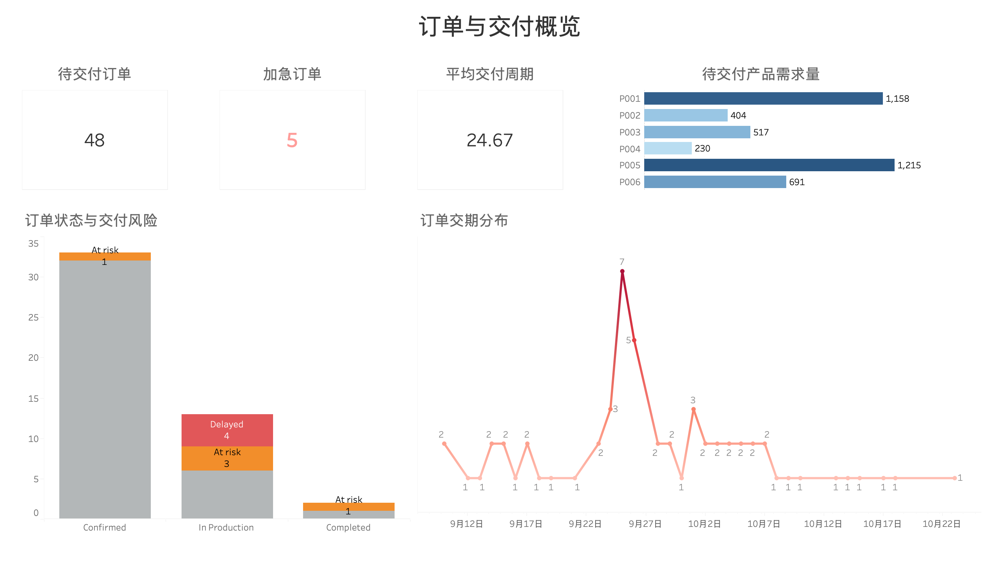
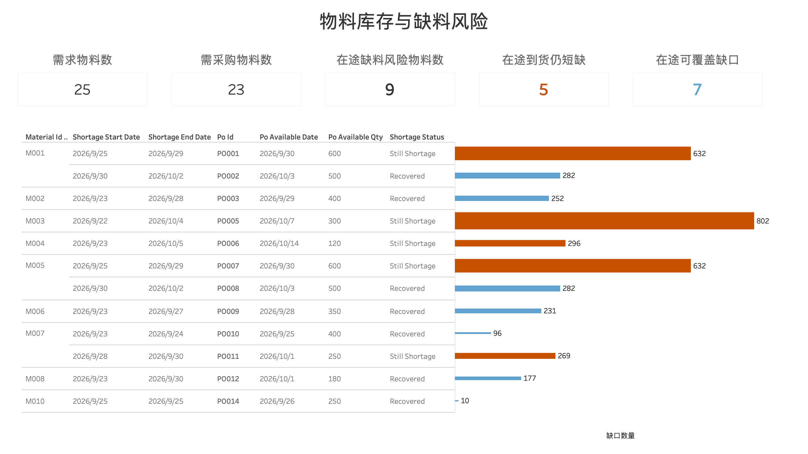
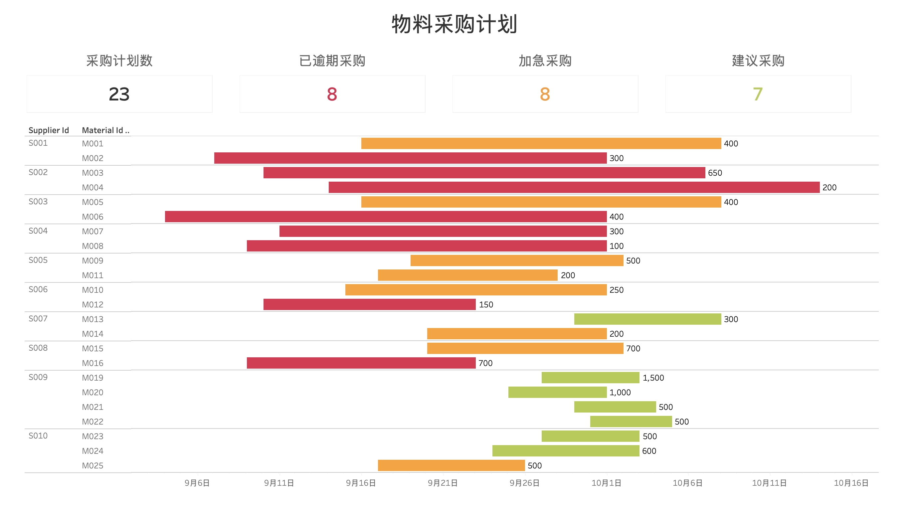

# 制造业 PMC 订单与物料计划分析项目

## 一、项目简介

本项目模拟一家机器人零部件及工业设备制造企业的 PMC 业务场景，围绕客户订单、产品 BOM、物料库存、在途采购订单和供应商采购周期，搭建从订单需求分析、MRP 物料需求计算、缺料风险识别到采购计划生成的分析流程。

项目使用 **PostgreSQL** 完成业务数据存储与核心 SQL 计算，使用 **Python** 辅助数据生成及流程处理，并通过 **Tableau** 构建订单交付、物料缺料和采购计划三个分析看板，帮助识别交付风险、评估在途采购覆盖情况，并形成采购优先级和建议采购数量。


## 二、项目目标

- 分析订单规模、产品需求、订单状态及交期分布，识别订单交付压力。
- 根据产品 BOM 将成品需求展开为物料毛需求。
- 结合库存、安全库存、在途采购订单、供应商提前期和来料检验时间，滚动计算物料预计库存。
- 识别缺料区间，判断在途 PO 到货后能否覆盖缺口。
- 对仍需采购的物料生成采购建议，并结合 MOQ、采购提前期和检验周期倒推建议下单日期。
- 通过 Tableau 将订单、缺料风险和采购计划转化为可筛选、可追踪的业务看板。

## 三、技术栈

| 技术 | 应用场景 |
|---|---|
| PostgreSQL| 数据建模、表关联、BOM 展开、MRP 计算、库存滚动、缺料识别、采购计划计算 |
| Python | 测试数据生成及数据处理辅助 |
| Tableau | 订单交付概览、物料库存与缺料风险、采购计划可视化 |
| Excel / CSV | 数据检查、结果核对与数据交换 |

## 四、业务流程

```text
客户订单与订单明细
        ↓
产品及 BOM 结构
        ↓
订单需求按 BOM 展开
        ↓
物料毛需求（Gross Requirement）
        ↓
库存 + 安全库存 + 在途采购订单
        ↓
MRP：按需求日期和到货可用日期滚动计算预计库存
        ↓
识别缺料区间与最低库存
        ↓
评估每批在途 PO 到货后的库存变化
        ↓
Still Shortage / Recovered / Need Purchase
        ↓
结合剩余缺口、MOQ、采购提前期和检验周期
        ↓
生成采购计划及建议下单日期
        ↓
Tableau 三个业务看板
```

## 五、数据模型

项目基础数据包括客户、产品、供应商、物料、BOM、库存，以及订单和采购业务数据(订单及订单明细由python生成，其他数据由AI辅助生成)。

### 基础业务表

- `customers`：客户及区域信息
- `products`：产品信息、标准生产周期和单价
- `suppliers`：供应商信息
- `materials`：物料类别、供应商、采购提前期、检验周期及 MOQ
- `bom`：产品与物料的组成关系及单位用量
- `inventory`：指定库存快照日期下的现有库存与安全库存
- `orders`：订单日期、要求交期、优先级及订单状态
- `order_items`：订单产品、数量及金额
- `purchase_orders`：在途采购订单、预计到货日期、订购数量及已收数量

### 计划分析表

- `mrp_gross_demand`：将符合计划口径的订单需求通过 BOM 展开，形成物料毛需求明细。
- `mrp_net_requirement`：按物料需求日期和采购到货可用日期汇总事件，滚动计算期初库存、计划到货、毛需求、预计库存及净需求。
- `material_shortage_events`：记录缺料区间、最低库存、安全库存、缺口数量，以及相关 PO 的可用日期、数量、到货后库存和状态。
- `planned_purchase_orders`：记录建议采购物料、供应商、需求日期、MOQ、建议采购量、建议下单日期、预计到货日期、预计可用日期和计划优先级。


## 六、核心业务逻辑

### 1. BOM 展开与物料毛需求

根据订单明细关联产品 BOM，将成品订单数量转换为各物料需求量：

`物料毛需求 = 订单产品数量 × BOM 单位用量`

同一物料被多个产品使用时，按物料及需求日期汇总需求，识别共享物料的需求压力。

### 2. MRP 与预计库存滚动

以 **2026-09-15** 为库存计划快照日期，按时间顺序整合物料需求事件和在途采购到货事件。

- 期初库存从库存快照读取，并随需求消耗和计划到货逐步滚动。
- 在途 PO 的预计可用日期 = 预计到货日期 + 来料检验天数。
- 预计库存允许低于安全库存甚至出现负数，以保留缺料风险的程度，而不是将异常库存截断为 0。
- 净需求用于衡量预计库存相对于安全库存的补足缺口。

### 3. 缺料区间与在途 PO 覆盖判断

当预计库存低于安全库存时，识别缺料区间，并记录区间最低库存及对应缺口。

对关联的在途 PO 按可用日期排序，逐批计算到货后的库存变化：

- **Still Shortage**：当前批次到货后，预计库存仍低于安全库存。
- **Recovered**：当前批次到货后，预计库存达到或超过安全库存。
- **Need Purchase**：没有可用于覆盖该缺料区间的在途 PO，且缺料仍未恢复。

该分析用于区分“已有采购在途但覆盖不足”和“需要新增采购”两类问题，避免只汇总全部 PO 数量而忽略到货时间差异。

### 4. 采购计划与优先级

对仍存在采购缺口的物料，结合 MOQ 和供应周期生成采购建议：

- 建议采购量结合剩余缺口和 MOQ 取整。
- 预计到货日期根据建议下单日期和采购提前期推算。
- 预计可用日期进一步考虑来料检验时间。
- 将建议下单日期与计划基准日期比较，区分已逾期、加急和普通建议计划。


## 七、Tableau 看板

### Dashboard 1：订单与交付概览

**分析目的：** 从订单规模、产品需求、订单状态和交期分布识别当前交付压力。

主要指标与图表：


- 待交付订单：48
- 加急订单：5
- 平均交付周期：24.67 天
- 待交付产品需求量：P001 和 P005 需求最高，分别为 1,158 和 1,215；P004 最低，为 230。
- 订单状态与交付风险：
  - Confirmed：33 单，其中 At risk 1 单
  - In Production：13 单，其中 Delayed 4 单、At risk 3 单
  - Completed：2 单，其中 At risk 1 单
- 订单交期分布：订单交期主要集中在 2026-09-23 至 2026-09-28。

**业务价值：** 快速掌握待交付订单规模，发现交期集中时段及存在延迟或风险的订单，为后续物料需求和采购安排提供支撑。

### Dashboard 2：物料库存与缺料风险

**分析目的：** 从物料维度识别库存不足、在途覆盖不足及需要新增采购的风险。

主要指标与图表：


- 需求物料数：25
- 需采购物料数：23
- 在途缺料风险物料数：9
- 在途到货仍短缺：5
- 在途可覆盖缺口：7
- 在途缺料风险事件明细：展示物料、缺料区间、缺口数量、PO 到货可用日期、到货数量、到货后库存及状态。

**业务价值：** 不只判断库存是否不足，还进一步评估在途采购到货后能否恢复到安全库存，帮助区分持续缺料风险和已可通过在途 PO 覆盖的缺口。

### Dashboard 3：物料采购计划

**分析目的：** 将缺料分析转化为可执行的采购建议，突出采购时点和处理优先级。

主要指标与图表：


- 采购计划数：23
- 已逾期采购：8
- 加急采购：8
- 建议采购：7
- 采购计划甘特图：按物料展示建议采购周期，并标注建议采购数量。
  - 红色：Overdue（已逾期）
  - 黄色：Urgent（加急）
  - 绿色：Suggested（普通建议）

**业务价值：** 快速确定优先处理的采购任务，并查看建议采购量及其时间要求。

## 八、关键分析结论


1. **关注订单交期集中风险：** 订单交期集中在 9 月 23 日至 9 月 28 日，需要优先检查相应订单的物料齐套情况。
2. **优先跟进在途覆盖不足的物料：** 对到货后仍低于安全库存的物料，应结合后续 PO 批次和剩余缺口继续判断，避免将“有 PO”误判为“风险已解除”。
3. **优先处理逾期及加急采购：** 当前采购计划中有 8 项已逾期、8 项加急，应优先核实供应商交期、下单状态和替代方案。
4. **将采购日期与物料需求日期联动：** 采购计划不仅需要关注采购数量，还需要确保物料在需求时点前完成到货及检验。


## 九、项目特点

- **业务链路完整：** 从订单需求、BOM 展开、MRP、缺料识别到采购建议，覆盖 PMC 物料计划的关键环节。
- **强调时间维度：** 将物料需求日期与 PO 可用日期结合，避免只按总量判断供需是否平衡。
- **考虑实际采购约束：** 引入安全库存、MOQ、采购提前期及来料检验周期。
- **SQL 与可视化结合：** 用 SQL 实现核心计算，通过 Tableau 将结果转化为可用于排查和跟进的业务视图。
- **结果可追溯：** 缺料风险可以追溯到相关物料、在途 PO 批次和采购计划建议。

## 十、项目目录

```text
manufacturing-pmc-analysis/
├── raw_data/
│   ├── customers.csv
│   ├── products.csv
│   ├── suppliers.csv
│   ├── materials.csv
│   ├── bom.csv
│   ├── inventory.csv
│   ├── orders.csv
│   ├── order_items.csv
│   └── purchase_orders.csv
├── sql/
│   ├── 0_create_database.sql
│   ├── 1_create_basic_tables.sql
│   ├── 2_load_basic_data.sql
│   ├── 3_create_order_tables.sql
│   ├── 4_mrp_gross_demand.sql
│   ├── 5_create_purchase_orders.sql
│   ├── 6_mrp_net_requirement.sql
│   ├── 7_material_shortage_events.sql
│   └── 8_planned_purchase_orders.sql
├── python/
│   └── generate_orders.py
├── mrp_data/
│   ├── material_gross_demand.csv
│   ├── material_shortage_events.csv
│   ├── mrp_net_requirement.csv
│   └── planned_purchase_orders.csv
├── tableau/
│   ├── 1_orders.png
│   ├── 2_shortage.png
│   └── 3_purchases.png
└── README.md
```

## 十一、口径与假设

- 库存计划基准日期为 2026-09-15。
- 当前 MRP 仅将 `Confirmed` 状态订单纳入本轮需求计算；`In Production`、`Completed` 和 `Delivered` 订单按物料已发料或已消耗处理，`Cancelled` 订单排除。
- 物料需求日期按订单要求交期减去产品标准生产周期估算。
- 当前版本假设生产所需 BOM 物料在生产开始前齐套，未进一步模拟工序级投料时点。
- 采购到货可用日期按预计到货日期加检验天数计算。
- 产品标准生产周期用于估算需求日期，不等同于基于实时产能和排程计算的生产计划。
- 采购计划为模拟数据下的建议结果，实际采购前需要结合最新需求、现有库存、供应商确认交期和企业采购规则复核。
- 项目使用模拟业务数据，分析结果用于展示业务建模与计划分析方法，不代表真实企业经营数据。


---

**项目定位：** 制造业 PMC / MC物控 / 供应链计划  
**核心工具：** PostgreSQL、Python、Tableau
